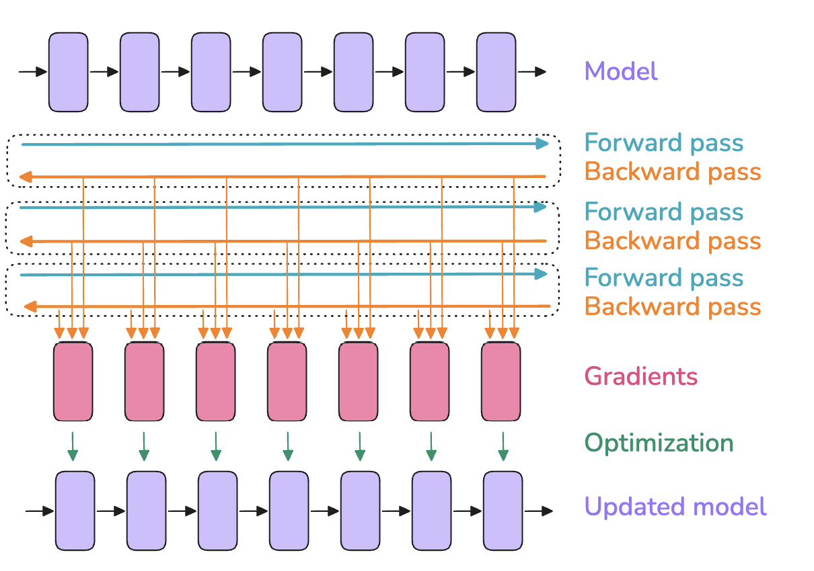
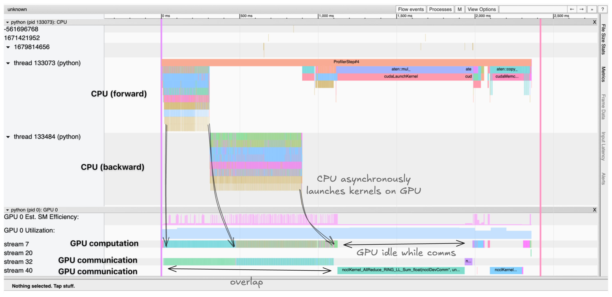

# 第 1 章　第一步：单 GPU 训练（First Steps: Training on one GPU）

> 译自 Hugging Face nanotron 团队《The Ultra-Scale Playbook: Training LLMs on GPU Clusters》（Apache 2.0），原文为 [Hugging Face Space](https://huggingface.co/spaces/nanotron/ultrascale-playbook)。

> 🎧 原文此处为 Podcast 音频播放器：若想为阅读增添 Podcast 氛围，可一边阅读、一边聆听 NotebookLM 主持人讨论本书前几节内容的对谈，请至[原网页](https://huggingface.co/spaces/nanotron/ultrascale-playbook)体验。

在开始扩展到多 GPU 之前，让我们先快速回顾模型训练最基本的概念。当模型在单张 GPU 上训练时，训练通常包含三个步骤：

1. 前向传播（forward pass）：将输入送入模型并生成输出；
2. 反向传播（backward pass）：计算梯度；
3. 优化步骤（optimization step）：使用梯度来更新参数。

正如我们稍后会看到的，这些步骤可能会重复或彼此交错，但现在我们先从简单的情况开始。

整体流程大致如下：

> 🔬 原文此处为交互图表（单 GPU 训练三步流程的网络示意图，可将鼠标悬停在网络组件上查看细节），可前往[原网页](https://huggingface.co/spaces/nanotron/ultrascale-playbook)体验。

在这张图中，最上排的方块可以视为模型内部依序排列的各层（最下排也一样），红色方块则是各层对应的梯度，在反向传播期间计算出来。

**批量大小（batch size，$bs$）**是模型训练的重要超参数之一，会同时影响模型收敛与吞吐量。

在训练初期，较小的批量有助于在优化空间（training landscape）中快速前进，找到更好的学习方向。但到了训练后期，小批量会让梯度持续带有噪声，模型可能无法收敛到最佳性能。另一方面，大批量虽然能给出更精确的梯度估计，却往往会降低每个训练词元（token）的利用效率，导致收敛变慢并浪费计算资源。OpenAI 关于大批量训练的论文和 MiniMax-01 [技术报告](https://filecdn.minimax.chat/_Arxiv_MiniMax_01_Report.pdf)第 4.2 节都对这一主题做过深入讨论。

举例来说，在 DeepSeek-V3/R1 的训练中，“批量大小在前 469B 个词元的训练期间，从 3,072 个输入序列逐步增加到 15,360，其余的训练则维持在 15,360 个输入样本”。

批量大小也会影响在给定文本数据集上的训练时间：批量越小，处理相同数量的样本就需要越多优化器步骤。由于优化器步骤的计算成本较高，小批量通常会延长总训练时间。不过，批量大小在最优值附近往往有较大的调整空间，而不会显著影响模型性能。换句话说，最终性能对这一范围内的具体批量大小通常并不敏感。

在 LLM 预训练领域，批量大小通常以词元数而不是样本数表示（$bst$ = batch size tokens，词元批量大小），从而避免它随实际输入序列长度而变化。

在最简单的情况（单机训练）下，$bs$（以样本计）与 $bst$ 可以由模型输入序列长度（$seq$）计算如下：

$$
bst = bs * seq
$$

从这里开始，我们将以样本为单位来呈现批量大小的公式，但你随时可以将它乘上序列长度，换算成以词元为单位的对应值。

近期 LLM 训练常用的批量大小约为 400 万到 6,000 万个词元。近年来，批量大小和训练语料规模都在持续增长：Llama 1 使用约 400 万词元的批量，在 1.4 万亿个词元上进行训练；DeepSeek 则使用约 6,000 万词元的批量，训练了 14 万亿个词元。

**而当我们把模型训练扩展到这么大的批量时，第一个挑战已经迎面而来：内存不足（out-of-memory，OOM）问题。当 GPU 的内存不足以容纳目标批量大小的完整批量时，我们该怎么办？**

我们先了解导致内存不足的原因，从而对模型训练的内存需求建立直观认识。

## Transformer 的内存占用分析（Memory usage in Transformers）

训练神经网络模型时，我们会在内存中存储以下几类项目：

* 模型权重
* 模型梯度
* 优化器状态（optimizer states）
* 计算梯度所需的激活（activations）

> 📝 **注**：模型的内存需求看似可以精确计算，但以下几项额外开销会增加估算难度：
>
> * CUDA kernel 通常需要 1–2 GB 的 GPU 内存。你可以运行 `import torch; torch.ones((1, 1)).to("cuda")`，再用 `nvidia-smi` 查看 GPU 内存，快速验证这一点。
> * 还有一些剩余的内存占用来自缓冲区（buffer）与中间结果，以及部分因碎片化（fragmentation）而无法使用的内存。
>
> 我们会忽略后两项因素，因为它们通常是较小且固定的常数项。

这些项目以张量形式存储，而张量有不同的“形状”与“精度”。“形状”由批量大小、序列长度、模型隐藏维度、注意力头数、词汇表大小，以及我们稍后会看到的模型切分（sharding）等超参数决定。“精度”指的是 FP32、BF16、FP8 等格式，分别需要 4、2、1 个字节来存储张量中的每一个数值。我们会在“混合精度训练”一节完整讨论各种精度及其取舍；目前只需记住，这些格式的内存需求各不相同，会影响我们所需存储项目的内存占用。

那么，要如何从这些变量快速判断内存使用量呢？一个简单的方法就是凭经验直接测量。

### 分析内存占用（Profiling the memory usage）

利用 PyTorch 分析器（profiler），我们可以观察整个训练过程中的内存分配情况。内存占用并非固定不变，无论是在完整训练期间，还是在单个训练步骤内，都会发生显著变化：

有关模型性能分析的完整介绍，请参阅〈A1：分布式训练性能分析（A1: Distributed Training Profiling）〉。

> 🔬 原文此处为交互图表（内存 profiler 时间轴，显示训练前几个步骤中权重、梯度、优化器状态与激活的内存占用随时间的变化），可前往[原网页](https://huggingface.co/spaces/nanotron/ultrascale-playbook)体验。

显然，第一个步骤看起来与后续步骤非常不同，但我们先来看看一个步骤的一般结构：首先，随着前向传播的进行，激活快速增加；接着在反向传播期间，梯度逐步累积起来，而随着反向传播的推进，用来计算梯度的已存储激活会被逐步清除。最后，我们运行优化步骤——此时需要所有的梯度——然后更新优化器状态，才开始下一次前向传播。

为什么第一个步骤看起来不同？激活值快速增加后，内存占用会暂时保持不变。这是因为 PyTorch 的缓存分配器（caching allocator）会在第一步完成大量准备工作，预先规划内存分配，使后续步骤无需反复寻找可用的内存块，从而提高速度（参见 [Zach 的博客](https://zdevito.github.io/2022/08/04/cuda-caching-allocator.html)）。第一步结束后，优化器状态也会出现，进一步抬高后续训练步骤的内存占用。

你是否注意过，有时训练在第一步能成功，却在后续的训练步骤中发生 OOM？这可以用第一步之后优化器状态的累积来解释。

有了这些基本认识后，我们会看到，扩展训练规模的核心任务就是：在将激活值、参数、梯度和优化器状态控制在 GPU 内存容量之内的同时，尽可能提高计算效率。

### 权重、梯度与优化器状态的内存占用（Weights/grads/optimizer states memory）

先从列表中的前三项开始：模型的权重、梯度与优化器状态。其实我们可以相当容易地估算它们所需的内存。

对于一个简单的 Transformer LLM，参数数量可由[下列公式](https://michaelwornow.net/2024/01/18/counting-params-in-transformer)给出：

$$
N = h * v + L * (12 * h^2 + 13 * h) + 2*h
$$

由于我们不使用固定位置嵌入（positional embedding），公式中排除了位置嵌入的参数量。

在这个式子中，$h$ 是隐藏维度，$v$ 是词汇表大小，$L$ 是模型的层数。观察这个式子可以发现，在隐藏维度较大时占主导地位的是 $h^2$ 这一项，因为随着参数规模扩大，它是唯一以平方增长的项。

参数与梯度的内存需求，就是参数数量乘以每个参数所需的字节数。在传统的全精度（FP32）训练中，参数和梯度都各需要 4 个字节；而优化器如果使用 Adam，还需要存储动量（momentum）与方差（variance），每个参数又各增加两个 4 字节。总结如下：

$$
\begin{aligned}
& m_{params} = 4 * N \\
& m_{grad} = 4 * N \\
& m_{opt} = (4+4) * N
\end{aligned}
$$

接着看看改用较低精度时情况会如何改变。基于稳定性的考虑（见后文的混合精度训练一节），我们通常不采用完全的低精度训练，而是混用较高与较低精度，称为“混合精度（mixed precision）”。目前混合精度训练的默认做法，通常是大多数运算使用 BF16——每个参数与梯度各需要 2 个字节——同时额外保存一份 FP32 的模型权重与梯度副本，因此每个参数总共需要 12 个字节。除了参数与梯度之外，我们还需要存储优化器状态：对 Adam 优化器而言，需要动量与方差，为了数值稳定性通常以 FP32 存储，各占 4 个字节。

后文介绍 ZeRO 方法时会有更多细节。

摘要如下：

$$
\begin{aligned}
& m_{params} = 2 * N \\
& m_{grad} = 2 * N \\
& m_{params\_fp32} = 4 * N \\
& m_{opt} = (4+4) * N
\end{aligned}
$$

> 📝 **注**：有些库以 FP32 存储梯度，这需要额外 $m_{params\_fp32} = 4 * N$ 的内存。例如 nanotron 就是这么做的，因为 `bf16` 对较小的数值是有损的，而我们始终以稳定性为优先。详情参见[这则 DeepSpeed issue](https://github.com/microsoft/DeepSpeed/issues/1773)。

> 📝 **注**：参数的 FP32 副本（$m_{params\_fp32}$）在文献与代码中有时称为“主权重（master weights）”。

有趣的是，混合精度本身并不会节省整体内存，它只是把内存以不同的方式分配到这三个组成部分；而且如果我们以 FP32 累积梯度，实际上还比全精度训练多出 4 个字节。它仍然是有利的做法，因为以半精度计算前向／反向传播能让我们（1）使用 GPU 上经过优化、速度更快的低精度运算，并且（2）降低前向传播期间的激活内存需求——如同上下图表所示，这是内存占用的一大部分。

下面直观比较一下不同规模的模型大致需要多少内存（全精度和混合精度的总量相同）：

| **模型参数量** | **FP32，或 BF16 不含 FP32 梯度累积** | **BF16 含 FP32 梯度累积** |
|---|---|---|
| 1B | 16 GB | 20 GB |
| 7B | 112 GB | 140 GB |
| 70B | 1120 GB | 1400 GB |
| 405B | 6480 GB | 8100 GB |

改用 FP8 训练取代 BF16 能进一步降低内存占用，但稳定性较差，目前仍是非常活跃的研究主题（见[这则推文](https://x.com/xariusrke/status/1826669126955278401)），我们稍后会更详细地介绍。

可以看到，模型一旦达到 **7B**（！），权重与优化器的需求就开始显著累加，并超过一般 GPU 的内存容量（例如 H100 GPU 的 80 GB）。

不过现在，先让我们从仍然能装入单张 GPU 的模型开始，看看内存预算中的最后一个大户：激活内存。

### 激活内存（Activations memory）

激活内存比权重、梯度和优化器状态更难计算，部分原因在于它取决于模型的输入。如果你不确定为什么反向传播需要存储激活，[这份参考数据](https://www.determined.ai/blog/act-mem-2)是很好的快速复习。仔细查看反向传播的计算方式之后，我们可以估算混合精度下激活所需的总内存，得到以下方程：

$$
m_{act} = L \cdot seq \cdot bs \cdot h \cdot (34 + \frac{5 \cdot n_{heads} \cdot seq}{h})
$$

式中 $L$ 是层数，$seq$ 是序列长度，$bs$ 是以样本计的批量大小，$h$ 是模型的隐藏维度，$n_{heads}$ 是注意力头数。

至于这些数字的精确推导，可以参考 NVIDIA 那篇关于重计算的原始论文——基本上就是对 Transformer 层中每个运算之间所有中间激活的大小逐一记帐。

这里有个有趣的观察：对于给定的模型，内存占用并非固定不变，而是随批量大小线性增长、随序列长度平方增长。这表示当我们增大批量或以更长的序列训练时，激活内存正是会爆炸的那一部分。我们可以用这个方程来观察不同序列长度下内存占用的变化，例如以 Llama 系列模型为例（`bs=1`）：

> 🔬 原文此处为交互图表（Llama 各尺寸模型在不同序列长度下，参数、梯度、优化器状态与激活内存占用的比较图），可前往[原网页](https://huggingface.co/spaces/nanotron/ultrascale-playbook)体验。

这张图说明了一个鲜明的事实：对短序列（或者类似地，小批量）而言，激活几乎可以忽略不计；但从大约 2k–4k 个词元开始，激活便开始占据可观的内存，而参数、梯度与优化器状态的用量（我们稍后会讨论）则大致与序列长度和批量大小无关。

**对于大量输入词元（也就是大批量／长序列）而言，激活将成为远超其他项目的最大内存负担。**

那么，如何控制这种“激活爆炸”呢？

是时候介绍我们的第一项技术了——**激活重计算（activation recomputation）**——它能帮助我们控制激活内存的占用上限，是当今大模型训练工具箱中不可或缺的工具。

## 激活重计算（Activation recomputation）

**激活重计算**也称为*梯度检查点（gradient checkpointing）*或*重新物化（rematerialization）*。其基本思路是：在前向传播时丢弃部分激活值以节省内存，并在反向传播时增加少量计算，按需重新生成这些激活值。不使用重计算时，我们会保存每两个可学习运算（例如前馈层、LayerNorm 等）之间的所有隐藏状态，以便在反向传播时计算梯度。使用重计算后，通常只在模型架构的少数关键位置保存激活值，其余激活值全部丢弃；反向传播需要时，再从最近保存的激活值开始重新执行一小段前向传播。简而言之，这是一种用计算换内存的方法，整体流程如下：

> 🔬 原文此处为交互图表（激活重计算的前向／反向流程示意图，可将鼠标悬停在网络组件上查看细节），可前往[原网页](https://huggingface.co/spaces/nanotron/ultrascale-playbook)体验。

选择要存储哪些关键激活，有以下几种策略：

* **完全重计算（Full）**：在 Transformer 模型的每层边界设置激活检查点。这种 `full` 策略需要为每一层重新执行前向传播，相当于在反向传播期间额外运行一次完整的前向传播。它最节省内存，但计算成本也最高，通常会让计算量和训练时间增加 30–40%。
* **选择性重计算（Selective）**：通常还有比完全重计算更好的选择。相关论文详细分析了哪些激活值占用最大，同时重计算所需的 FLOPs 最少。注意力（attention）运算恰好属于这一类，因此通常可以丢弃其激活值，并将检查点保留在计算成本较高的前馈（feedforward）运算周围。对于 GPT-3（175B），这种方法可以**用 2.7% 的额外计算换取 70% 的激活内存削减**。

在 DeepSeek V3 等近期模型中即采用了选择性检查点，通过所谓的“多头潜在注意力（Multi-Head Latent Attention，MLA）”存储尺寸更小的注意力激活，以优化激活内存占用。

让我们看看在实践中，重计算策略能多大幅度地降低内存占用，以及选择性重计算如何在节省内存与重计算成本之间取得良好的平衡：

> 🔬 原文此处为交互图表（各种重计算策略在不同模型尺寸与序列长度下的内存占用比较图），可前往[原网页](https://huggingface.co/spaces/nanotron/ultrascale-playbook)体验。

这里还能清楚看到另一个趋势：长序列的激活对较小的模型影响更大，因此重计算的效果也变得更加显著。

> 📝 **注**：当你在衡量训练设置对 GPU/TPU/加速器的使用效率时，通常要把重计算纳入考虑来计算总 FLOPS（每秒浮点运算次数），并与 GPU/TPU/加速器的理论最大 FLOPS 比较。计算一个训练步骤的 FLOPS 时把重计算算进去，得到的值称为“硬件 FLOPS（hardware FLOPS）”，也就是加速器上实际运行的运算数量。将这个数字除以训练步骤的时间长度与加速器的最大 FLOPS，就得到**硬件 FLOPS 使用率（Hardware FLOPS Utilization，HFU）**。
>
> 然而，到头来真正重要的是模型在给定数据集上从头到尾的训练时间。所以在比较各种 GPU/TPU/加速器时，如果其中一种加速器提供了足够的内存、可以跳过重计算，因此每秒运行的运算较少（HFU 较低）却能更快完成训练，那它应该得到奖励而非惩罚。因此，另一种做法是计算所谓的**模型 FLOPS 使用率（Model FLOPS Utilization，MFU）**：与 HFU 不同，它只计入模型前向＋反向传播所需的运算，不把重计算计入测得的 FLOPs。这个数值因此更贴近模型本身，而非训练的具体实现。

现今大多数训练框架都使用 FlashAttention（我们会在后文进一步介绍），它在其优化策略中原生集成了激活重计算：在反向传播时重计算注意力分数与矩阵，而不是存储它们。因此，大多数使用 Flash Attention 的人其实已经在使用选择性重计算了。

**激活重计算会略微增加 FLOPs，却能大幅降低内存访问开销。**

这种取舍对高速内存容量有限的硬件（如 GPU）尤其有利，因为内存访问通常比计算更慢。虽然增加了部分计算，但最终往往既能加快运行速度，又能显著降低内存占用。

现在我们学会了重计算，就能如前面图表所示，驯服激活的内存占用了！

不过，激活值仍会随批量大小线性增长，而上面条形图中的分析均基于 `bs=1`。批量继续增大后，内存仍可能成为问题。为此，我们可以使用第二种工具：**梯度累积（gradient accumulation）**。

## 梯度累积（Gradient accumulation）

梯度累积是一种避免内存爆炸的直接方法：先把批量切分成多个微批量（micro-batch），依次对每个微批量运行前向与反向传播并计算梯度，再在执行优化器步骤之前对所有微批量的梯度求和。实际更新时使用的是梯度平均值，而不是总和，因此结果不会受到梯度累积步数的影响。

我们把每次前向传播的批量大小称为`微批量大小`（micro batch size，$mbs$），把两次优化器步骤之间的整体批量大小称为`全局批量大小`（global batch size，$gbs$）。如果我们每 8 次前向／反向传播才运行一次优化器步骤，`全局批量大小`就是`微批量大小`的 8 倍。

这里的`全局批量大小`，就是前文为简化表达而简称的`批量大小`；从现在开始，我们将使用更精确的术语以避免歧义。

使用梯度累积时，全局批量大小可以简单地计算如下：

$$
bs = gbs = mbs \times grad\_acc
$$

梯度累积可以在内存占用基本不变的情况下显著增大有效批量。它也可以和激活重计算配合使用，进一步降低内存占用。



使用梯度累积意味着我们需要保留梯度累积缓冲区，它们会在整个训练步骤中持续存在；而不使用梯度累积时，反向传播中的梯度是在释放激活内存的同时计算的，因此峰值内存较低。

梯度累积让我们每次只计算部分批量（也就是微批量），得以降低随批量大小线性增长的激活内存。

**它的缺点是，每个优化器步骤需要连续执行多次前向和反向传播，因此会增加计算开销并拖慢训练。**

不过，各微批量的前向和反向传播其实可以并行执行：它们彼此独立，区别只在于输入样本不同。因此，是时候把训练扩展到多张 GPU 了。

在此之前，我们先了解如何将计算和通信过程可视化，并介绍分布式训练中最实用的工具之一：**分析器（profiler）**。它可以帮助我们理解和验证 GPU 之间的计算与通信过程，并定位性能瓶颈。

### 分析 GPU 计算与通信（Profiling GPU compute and communication）

PyTorch 的[分析器](https://pytorch.org/tutorials/recipes/recipes/profiler_recipe.html)让我们能精确跟踪并可视化训练期间 CPU 与 GPU 上所发生的一切。它原生集成于 PyTorch 中。让我们看看如何使用：

```python
with torch.profiler.profile(
    activities=[
        torch.profiler.ProfilerActivity.CPU,
        torch.profiler.ProfilerActivity.CUDA,
    ],
    schedule=torch.profiler.schedule(wait=1, warmup=1, active=3),
    on_trace_ready=torch.profiler.tensorboard_trace_handler('./log/profile'),
    with_stack=True
) as prof:
    for step in range(steps):
        train_step()
        prof.step()
```

这会生成一份跟踪记录（trace），可在 TensorBoard 或 Chrome 的 trace viewer 中可视化。跟踪记录会显示：

* CPU 线程向 GPU 异步提交内核
* 多条 CUDA 流（stream）并行处理计算与通信
* 内核运行时间与内存分配情况


*示例跟踪记录：CPU 线程向 GPU 异步提交内核，计算内核与通信在不同的 CUDA 流上并行执行。*

跟踪记录有助于找出以下这类瓶颈：

* 原本可以重叠、却被串行执行的计算与通信
* GPU 等待数据传输的闲置时间
* CPU 与 GPU 之间的内存传输
* CPU 提交内核的启动开销（launch overhead）

理解这些模式，对于优化分布式训练性能至关重要。举例来说，我们稍后将讨论的梯度同步是否与反向传播的运算妥善重叠，跟踪记录就能清楚地显示出来。

现在，让我们换一台配备多张 GPU 的更大工作站 🖥️，开始研究我们的第一项扩展技术：**数据并行（data parallelism）**——我们将会看到，*它其实就是梯度累积的并行版本*。
