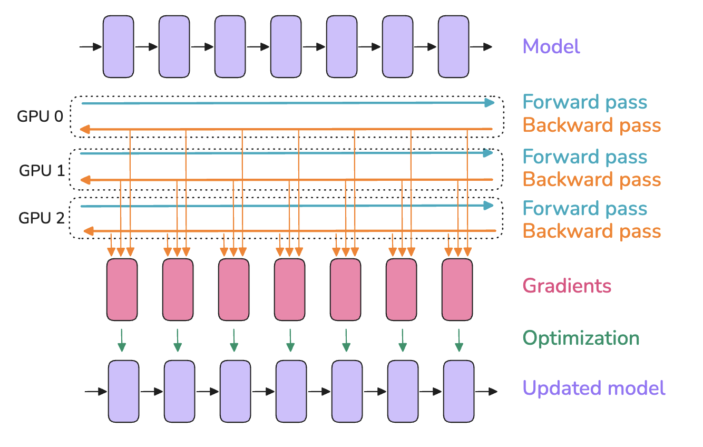
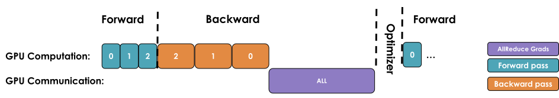
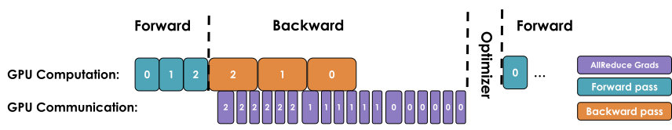
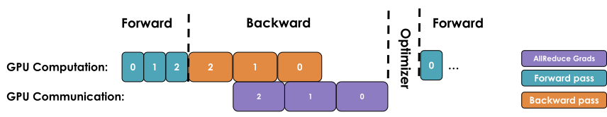
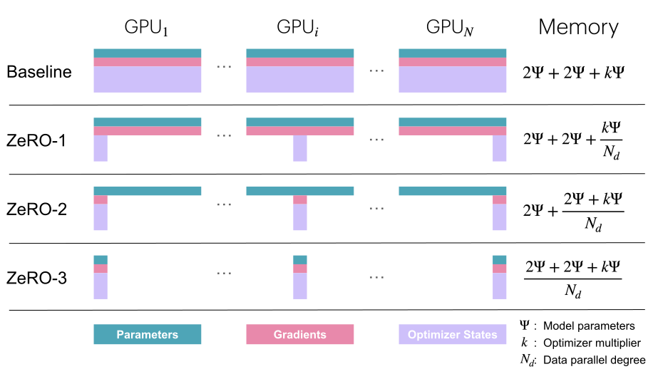
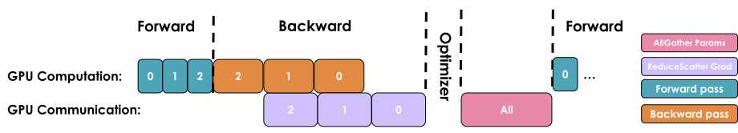
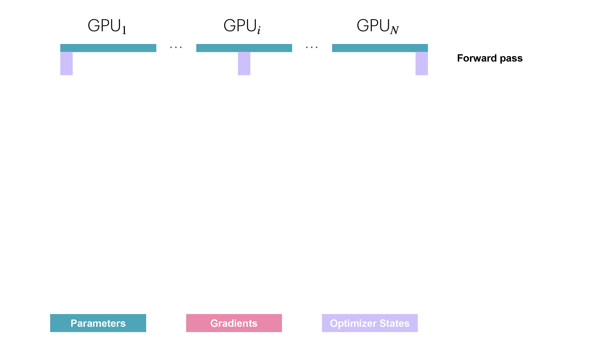
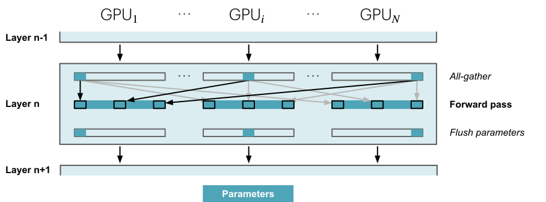
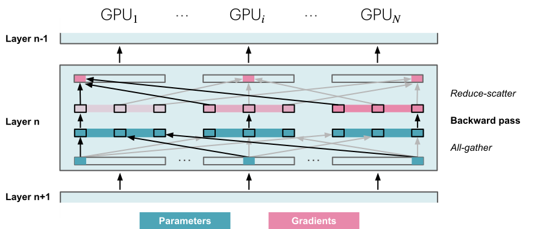
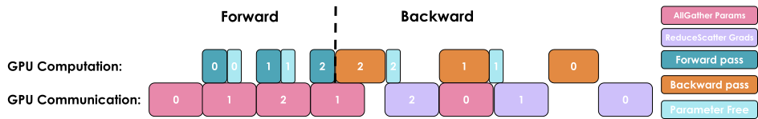

# 第 2 章　数据并行（Data Parallelism）

> 译自 Hugging Face nanotron 团队《The Ultra-Scale Playbook: Training LLMs on GPU Clusters》（Apache 2.0），原文为 [Hugging Face Space](https://huggingface.co/spaces/nanotron/ultrascale-playbook)。

> 🎧 原文此处嵌入一段由 NotebookLM 主持人讨论本节内容的 Podcast 音频，为阅读增添广播节目氛围，可前往[原网页](https://huggingface.co/spaces/nanotron/ultrascale-playbook)聆听。

数据并行（data parallelism, DP）背后的想法，是将模型拷贝到多张 GPU 上（我们把这些副本称为“模型实例”（model instances）），并在每张 GPU 上以不同的数据微批量（micro-batch）并行运行前向与反向传播——这正是“数据并行”名称的由来。你或许已经在简单的训练示例中见过数据并行，但我们在本节会钻研得更深，所以即使你已熟悉大致做法，也请继续看下去。



> 如果你还不熟悉 broadcast、gather、all-reduce 这类分布式通信模式，我们在〈A0：并行编程速成班〉中准备了一堂小小的速成课。

由于每张 GPU 使用不同的微批量，各 GPU 上算出的梯度也会不同。为了让不同 GPU 上的模型实例保持同步，我们会用一种称为“all-reduce”的操作将各模型实例的梯度取平均；这个操作发生在反向传播期间、优化器步骤之前。

这里出现了我们的第一个“分布式通信”原语（primitive）：**all-reduce**，它负责 GPU 实例与节点之间的同步与通信。



最简单的 DP 实现会等到反向传播完全结束、获得所有梯度后，才在全部 DP rank 上触发一次 all-reduce 来同步梯度。但“先计算、后通信”的串行流程效率很低，因为通信期间 GPU 会像上图那样处于闲置状态。

相反地，我们应该尽可能让通信与计算重叠（overlap），让两者尽量同时进行。

接下来我们来看三项优化，它们能让我们做得比朴素的第一版实现好得多！

## 第一项优化：让梯度同步与反向传播重叠

我们刚才描述的朴素 DDP 做法，主要缺点在于反向传播（*计算*）结束之后，必须先等待梯度同步（*通信*）完成，才能更新参数。我们能不能让这段通信与计算重叠呢？答案是可以！

如下图所示，某一层的梯度（红色方块）可以在更前面几层的梯度（左侧的红色方块）尚未算完之前，就先进行汇集与求和。举例来说，最后一层的反向传播一完成（最右边的方块），那些梯度就可以马上开始汇集求和，同时反向计算继续往左边、往更前面的层推进。



在 PyTorch 中，这可以通过为每个参数挂上一个 *all-reduce hook 函数*来实现：只要某个参数的梯度就绪，就立刻触发该参数的 all-reduce，此时其他参数的梯度仍在计算中。这种做法让大多数 all-reduce 操作与梯度计算重叠，从而提升效率。以下是一个挂上 hook 的简单函数：

```python
def register_backward_hook(self, hook):
    """
    Registers a backward hook for all parameters of the model that
    require gradients.
    """
    for p in self.module.parameters():
        if p.requires_grad is True:
            p.register_post_accumulate_grad_hook(hook)
```

让计算与通信重叠，可以缩短整个模型等待梯度同步的时间。梯度同步（至少一部分）能与反向传播并行进行，大幅加速数据并行。以下是含同步重叠的朴素 DP 完整实现：

> 👉 **Picotron 中含重叠的朴素 DP 实现**：原文此处嵌入可展开的代码，参见 [picotron/data_parallel/data_parallel.py（L10–L60）](https://github.com/huggingface/picotron/blob/0035cce0e04afd6192763b11efe50010d8ad0f71/picotron/data_parallel/data_parallel.py#L10-L60)。

这是我们第一次见到“*计算与通信重叠*”这个概念，本书后续还会多次讨论它——它是把扩展效率推到极致的关键技术。不过，我们还能把效率再往上提！

## 第二项优化：梯度分桶（bucketing）

无论是计算还是通信，在一个大张量上运行一次操作，通常都比在许多小张量上反复运行更高效。因此，可以将梯度分组装入“桶”（bucket），对每个桶内的全部梯度只发起一次 all-reduce，而不是为每个梯度单独运行 all-reduce。整体流程如下：



可以把它想成寄货前先把物品装箱：寄几个大箱子比寄一堆小包裹更高效。对每个桶只运行一次 all-reduce 操作，能大幅降低通信负担、加速通信操作。

以下是含分桶的代码实现：

> 👉 **Picotron 中的分桶 DP 实现**：原文此处嵌入可展开的代码，参见 [picotron/data_parallel/data_parallel.py（L62–L171）](https://github.com/huggingface/picotron/blob/0035cce0e04afd6192763b11efe50010d8ad0f71/picotron/data_parallel/data_parallel.py#L62-L171)。

## 第三项优化：与梯度累积的搭配

最后，如我们先前所见，梯度累积（gradient accumulation）的做法是先运行多次前向与反向传播，再以 `optimizer.step()` 更新参数。把梯度累积与数据并行结合时，我们得留意梯度同步的时机。

在朴素的版本中，累积期间每一次反向传播结束都会自动触发一次 all-reduce。这并不理想，因为只在最后一步之后做一次 reduce 就能达到相同效果，还能减少额外开销。

在 PyTorch 中，典型的解法是为那些不需要 reduce 的反向传播加上 [`model.no_sync()`](https://github.com/pytorch/pytorch/blob/5ea67778619c31b13644914deef709199052ee55/torch/nn/parallel/distributed.py#L1408-L1435) 修饰器来停用梯度同步。

> 📝 **注**：运行通信操作时，张量在内存中必须是连续的（contiguous），以避免多余的内存拷贝。为了做到优化，我们通常会预先配置与激活值或模型参数同样大小的连续缓冲区，专门用于通信。这虽然加速了通信，却也在一定程度上推高了训练期间的内存占用峰值。

现在，让我们来看看这对全局批量大小意味着什么。

## 重新审视全局批量大小

我们可以把新加入的数据并行与梯度累积参数放进批量大小的公式里：

$$
bs = gbs = mbs \times grad\_acc \times dp
$$

其中 $grad\_acc$ 是梯度累积步数，$dp$ 是用于数据并行的并行实例数。

因此，在目标全局批量大小不变的情况下，可以用更多数据并行进程减少梯度累积步数，从而加快训练。

在实践中，通常会优先增加数据并行节点数（DP），因为数据并行可以同时执行，而梯度累积必须依次运行。只有当全部 GPU 都已投入数据并行，却仍达不到目标全局批量大小时，才会在数据并行之上叠加梯度累积。

> 如需进一步了解数据并行，可以阅读：<https://siboehm.com/articles/22/data-parallel-training>。

能把训练分散到不同的样本上，等于给了我们第一个并行化维度，这就是 1D 并行（我们之后会逐步介绍另外四个维度）。

## 进展回顾

下面总结如何搭建第一个 1D 并行训练，并给出一套确定数据并行配置的初步流程：

1. 首先，通过查阅文献或运行测量模型收敛性的实验，决定最佳的（全局）批量大小（以 token 计，`GBST`）。
2. 接着确定训练使用的序列长度，同样可以参考文献或运行实验。一般来说，2k 至 8k 个 token 在当前评测中都能带来稳定表现。这里不深入讨论训练配方，但各团队通常会在训练后期加长序列，并在数据中加入部分长上下文样本，以获得目前所需的长上下文能力。
3. 现在我们知道了批量大小（gbs）。我们可以在单张 GPU 上不断调高本地批量大小，直到内存不足为止，借此找出最大的本地批量大小（mbs）。
4. 最后，确定目标 DP 可用的 GPU 数量。GBS 与 DP 的比值，就是为了达到所需 GBS 还需要的梯度累积步数。

> 例如 DeepSeek 与 Llama 系列模型在主要预训练阶段都是以 4k token 的序列长度训练的。
>
> 2–8k 的长度之所以适合预训练，是因为网络上更长的文档其实非常罕见。详细分析请见 [Harm 的博客文章](https://www.harmdevries.com/post/context-length/)。

如果算出的梯度累积步数小于 1，说明可用 GPU 数量超过了当前批量的需求。此时可以选择不使用全部 GPU、尝试更大的全局批量，或测试降低 MBS 能否加快训练。最后一种做法优先追求整体吞吐量，而不是单张 GPU 的计算效率，因此会有意使用低于内存上限的 MBS。

来看一个具体例子。假设我们要以 4M token 的 GBS 和 4k 的序列长度训练一个新模型，对应的批量大小为 1,024 个样本（取最接近的 2 的幂）。单张 GPU 的内存只能容纳 MBS=2，而我们有 128 张 GPU 可用。此时，只需累积 4 步梯度，就能让每个训练步骤处理 1,024 个样本，也就是达到 4M token 的目标。如果可用 GPU 突然增加到 512 张，则可以保持 MBS=2，并把梯度累积步数降为 1；这样既能维持相同的 GBS 和训练过程，又能提高速度。

> 📝 **注**：请记得，在 512 张以上 GPU 的规模下，取决于所用的网络，通信操作会开始受制于*环状延迟*（ring latency，信号绕环一圈所需的时间），这代表我们再也无法把 DP 通信完全重叠掉。这会降低计算效率、拖累吞吐量。此时我们就该开始探索其他的并行化维度了。

虽然数据并行能巧妙地把 all-reduce 梯度同步与反向计算重叠来节省时间，这项好处在大规模下会开始失效。为什么？因为随着我们加入越来越多 GPU（数百甚至数千张），彼此协调的开销会显著增加，网络需求也大到让效益不再划算。结果就是：每往系统多加一张 GPU，整体配置的效率就更低一些。

让我们用一些基准测试来看看实际情况：

> 🔬 原文此处为交互图表（不同 DP 规模下的吞吐量与每 GPU 内存占用基准测试），可前往[原网页](https://huggingface.co/spaces/nanotron/ultrascale-playbook)体验。

可以看到，超过某个上限后，吞吐量开始明显下降，而每张 GPU 的内存占用保持不变，不会因为增加 DP rank 数量而降低。

**数据并行是我们把训练扩展到更多 GPU 的第一个（简单）策略。这项技术的运行方式类似梯度累积，但把微批量的前向与反向传播并行化了，因此提升了吞吐量！**

不过，上述方法有一个前提：至少要能把单个输入样本的前向传播（mbs=1）装入 GPU 内存。现实中并非总能做到。如下所示，大模型即使启用激活重计算（activation recomputation），也可能无法装入单张 GPU：

> 小诀窍：你可以把参数量乘以 2，快速估算模型参数所需的最低内存，例如 70B → 140GB（=133GiB）。

> 🔬 原文此处为交互图表（各种模型规模的内存占用，显示大型模型即使打开激活重计算也无法放入单张 GPU），可前往[原网页](https://huggingface.co/spaces/nanotron/ultrascale-playbook)体验。

我们也看到了，数据并行在超过一定的扩展规模后，会开始出现制约性的通信开销。对于这些更大的模型或更大的批量大小，我们还有其他选择吗？幸好是有的：这些解法要么把部分张量移到 CPU，要么把权重／梯度／优化器状态等张量切分到多张 GPU 设备上！让我们开始深入研究。

切分主要有两条路径：并行化（张量并行、上下文并行或流水线并行）和分片（sharding；DeepSpeed ZeRO 或 PyTorch FSDP）。二者在一定程度上彼此正交，也可以组合使用。

分片这套范式与 DP 关系密切，所以我们先从它看起，研究一下 ZeRO 方法！

## ZeRO（Zero Redundancy Optimizer，零冗余优化器）

本节将介绍 DeepSpeed ZeRO（**Ze**ro **R**edundancy **O**ptimizer），一种旨在减少 LLM 训练中内存冗余的内存优化技术。

虽然数据并行是扩展训练的高效方式，但把优化器状态、梯度与参数朴素地拷贝到每个 DP rank 上，会引入可观的内存冗余。ZeRO 的做法是沿着数据并行维度切分（partition）优化器状态、梯度与参数，同时仍允许使用完整参数集进行计算，借此消除内存冗余。这有时需要 DP rank 之间更多的通信，而这些通信能否被完全重叠掉，我们接下来就会看到！

> 本书聚焦于 ZeRO-1 到 ZeRO-3，这应该足以让你全面了解它如何帮助降低内存，以及需要权衡的取舍。更多 ZeRO 变体可参阅 [DeepSpeed 文档](https://www.deepspeed.ai/tutorials/zero/)。

这套方法分为三个可能的优化阶段（stage）：

* ZeRO-1：切分优化器状态
* ZeRO-2：切分优化器状态＋梯度
* ZeRO-3（亦称 FSDP，即“完全分片数据并行”（Fully-Sharded Data Parallelism））：切分优化器状态＋梯度＋参数

> 这里说的“切分”是指沿着 DP 轴切，因为 ZeRO 属于数据并行的一环。稍后我们会看到，也可以沿着其他轴切分。

注意，可分片的列表中没有激活值。这是因为每个 DP 副本接收不同的微批量，各 DP rank 上的激活值本来就不相同，不存在可以消除的重复副本。

下面具体分析各个 ZeRO 阶段能节省多少内存。

### 重新审视内存占用

前一节介绍了标准训练中优化器状态、梯度和参数的内存占用。这里将模型参数量记为 $\Psi$（前文使用 $N$，此处改用 ZeRO 原论文中的符号）。采用混合精度训练（详见后续章节）和 Adam 优化器时，各项内容的内存占用如下：

* 模型参数（半精度，即 bf16/fp16）：$2\Psi$
* 模型梯度（半精度，即 bf16/fp16）：$2\Psi$
* fp32 的模型参数与优化器状态：$4\Psi + (4\Psi + 4\Psi)$
* fp32 的模型梯度：$4\Psi$（可选，只有想以 fp32 累积梯度时才计入）

如果不以 fp32 累积梯度，总内存消耗为 $2\Psi + 2\Psi + 12\Psi$；如果要累积，则是 $2\Psi + 6\Psi + 12\Psi$。为了简化，我们先聚焦在不做 fp32 梯度累积的情况；若有需要，只要把受 ZeRO-2 与 ZeRO-3 影响的梯度项加上那些额外字节即可。

ZeRO 的想法是把这些对象分片到各个 DP rank 上，每个节点只存储其中一个切片（slice），需要时才重建完整项目，从而让内存占用除以数据并行度 $N_d$：


*其中 $\Psi$ 表示参数量，$k$ 表示优化器状态的内存倍率（如前所述，Adam 的 $k=12$），$N_d$ 表示 DP 度（DP degree）。*

让我们通过逐一探索各个 ZeRO 阶段的运行方式，来解释这张图及其中的数值。先从 ZeRO-1 开始。

### ZeRO-1：切分优化器状态

在原生（vanilla）DP 中，所有 rank 在反向传播后汇集相同的梯度，并同时运行一模一样的优化器步骤。这看起来是大量的重复工作。我们能不能避免它、同时还降低内存占用呢？

在 ZeRO-1 中，优化器状态被切分成 $N_d$ 等份，其中 $N_d$ 是 DP 度。这表示分布在各 DP rank 上的每个模型副本，只保管 $\frac{1}{N_d}$ 的优化器状态；在优化步骤中，也只有 $\frac{1}{N_d}$ 的 float32 权重被更新。

然而在前向传播时，每个副本都需要完整的参数。因此我们得在优化器步骤之后加上一次额外的 **all-gather**（我们遇到的第二种集体通信原语！），让每个模型副本都拿到完整的最新权重。

这就解释了我们在上图中看到的内存公式 $2\Psi + 2\Psi + \frac{k\Psi}{N_d}$！以下是单个训练步骤的操作顺序摘要：

1. 在每个副本上以同一组完整的 bf16 参数运行前向传播，但各副本处理不同的微批量。
2. 在每个副本上以同一组完整的梯度运行反向传播，但各副本处理不同的微批量。
3. 对梯度运行 reduce-scatter（我们会在下方图中说明 reduce-scatter 原语）。
4. 每个副本对其本地的优化器状态（仅 $\frac{1}{N_d}$ 的优化器状态）运行一步优化，得到更新后的 $\frac{1}{N_d}$ fp32 参数，再转换成完整 bf16 参数集中属于自己的那 $\frac{1}{N_d}$。
5. 对 bf16 参数运行 all-gather，把缺少的切片发回各个副本。这是 ZeRO 添加的操作，原生 DP 中并不使用。

> 注：reduce-scatter 的速度是 all-reduce 的两倍。这也是本书介绍的第三种通信原语。

你可能想知道这个“reduce-scatter”操作到底是什么、整个流程长什么样子，所以让我们用下图把它变得更直观。我们会走一遍前向／反向传播循环的所有步骤：


从实际通信来看，与原生 DP 相比，ZeRO-1 将梯度通信从 all-reduce 改为 reduce-scatter，并在优化器步骤之后增加一次针对所有参数的 all-gather，如下所示：



前文提到，在原生 DP 中，可以将 all-reduce 梯度通信与反向传播计算重叠。在 ZeRO-1 中，也可以尝试将新增的 bf16 参数 all-gather 高效地重叠起来。主要有两种策略：

* **在优化器步骤期间**：优化器一更新完部分参数，就立刻发起 all-gather。这让通信有机会与其余参数的更新重叠。
* **在前向传播期间**：把每一层参数的 all-gather 与前向传播重叠。

> 📝 **注**：这些技巧并不容易实现，需要巧妙地使用 hook 和分桶。在实践中，可以直接使用 PyTorch 原生的 ZeRO-3/FSDP 实现，并将整个模型设为 FSDPUnit，具体细节将在后文介绍。

在 ZeRO-1 中，优化器状态已经切分，因此每个副本只更新 $\frac{1}{N_d}$ 的优化器状态。由此不难发现：既然优化步骤只需要一部分梯度，就没有必要让所有 DP rank 都持有完整梯度。这正是 ZeRO-2 的出发点。

### ZeRO-2：进一步切分梯度（gradient partitioning）

既然每个副本只需要对应其优化器状态分片的那份梯度分片，那么把梯度也比照优化器状态分片就很合理。如此一来，在反向传播期间，我们不再对梯度运行 all-reduce，而是只运行一次 **reduce-scatter** 操作！我们只在内存中散布各自需要的 $\frac{1}{N_d}$ 梯度，因此比 ZeRO-1 又省下更多内存。

> 若采用 fp32 梯度累积，我们只需保留 $\frac{1}{N_d}$ 的 fp32_grads，用来累积 reduce-scatter 传来的 bf16 梯度；优化器步骤中使用的正是这 $\frac{1}{N_d}$ 的 fp32_grads。



现在很容易看出，把梯度也分片之后，内存变成 $2\Psi + \frac{2\Psi+k\Psi}{N_d}$；随着 $N_d$ 增加，我们最多能比基准省下 8 倍的内存。就通信而言，流程与 ZeRO-1 相同，唯一的差别是我们边通信、边实时释放内存。整体来说，ZeRO-2 在通信方面也与原生 DP 训练等价。

在通信上，ZeRO-2 与 ZeRO-1 相似：两者都需要对梯度做一次 reduce-scatter，并对所有参数做一次 all-gather。


> 注：与 ZeRO-1 相比，ZeRO-2 几乎没有实质性的额外开销，因此通常是更好的选择。

梯度分片之后，还能否继续使用相同思路？答案是肯定的，这就是 ZeRO-3。

### ZeRO-3：进一步切分参数（parameter partitioning）

在第三阶段，我们把前述“沿 DP 副本切分优化器状态与梯度”的做法，进一步延伸到切分模型的参数。

> 📝 **注**：这个阶段在 PyTorch 原生实现中也称为 FSDP（Fully Sharded Data Parallelism，完全分片数据并行）。本书一律称之为 ZeRO-3，但你在任何地方看到 FSDP，都可以把它想成同一件事。

如果模型的所有部分都分散存储，该如何运行前向和反向传播？做法很直接：在需要时按需（on-demand）收集相应内容。前向传播过程如下：



执行前向传播时，每一层都会按需获取必要参数，并在使用完毕后立即从内存中释放。反向传播的方式相同，只是顺序相反，最终生成梯度分片：



另一个问题是，整个前向和反向传播过程中都要反复运行 all-gather。与 ZeRO-2 相比，**每个训练步骤**会多出 $2\cdot \text{num\_layers} - 1$ 次 all-gather，而每次操作都会带来少量**基础延迟**（base latency），如下图所示：



在前向传播期间，我们会在需要参数时运行 all-gather，产生 $\Psi$ 的通信开销。由于参数在前向传播中用完即被丢弃，反向传播期间还要再做一轮 all-gather，又会产生 $\Psi$ 的通信开销。最后，还要像 ZeRO-2 一样用 **reduce-scatter** 处理梯度，同样需要 $\Psi$ 的通信量。三者合计为 $3\Psi$，而 ZeRO-2 只需 $2\Psi$。

虽然通信量看起来很大，但可以通过**预取（prefetching）**，将下一层参数的通信与当前层的前向传播重叠。计算前向传播的 *Layer n* 时，同时对 *Layer n+1* 的权重执行 all-gather；计算反向传播的 *Layer n* 时，则同时对 *Layer n-1* 的权重执行 all-gather。不过，这种重叠只在 DP 规模不过大时有效，经验上 DP 不应超过 512。

在内存方面，最终公式为 $\frac{2\Psi + 2\Psi + k\Psi}{N_d}$。这意味着，只要不断增加 DP rank 数量，至少在模型相关的部分上，内存占用就可以持续降低。但要注意，这种方法无法减少中间激活值占用的内存；这部分可以用前面介绍的激活检查点（activation checkpointing）和梯度累积来处理。

**总结来说，DP 通过增加模型副本扩展训练，并显著提高吞吐量；ZeRO 则沿 DP 维度切分参数、梯度和优化器状态，使原本无法装入单张 GPU 的模型也能训练，代价是增加少量通信开销。**

> 如果你想深入了解 FSDP1、FSDP2 以及它们相关的一些实现细节与复杂之处，建议花点时间读读[这篇不错的博客](https://christianjmills.com/posts/mastering-llms-course-notes/conference-talk-012/)。

不过，这种方法也有局限：只有当模型的单层能够装入一张 GPU 时，DP 才可行；而 ZeRO 只能切分参数、梯度和优化器状态，无法切分激活值。前文提到，激活值内存会随序列长度和批量大小增长。虽然可以直接限制二者，但我们并不希望因为硬件限制而被迫使用短序列训练。

> 🔬 原文此处为交互图表（ZeRO-3 之下不同模型规模的内存占用），可前往[原网页](https://huggingface.co/spaces/nanotron/ultrascale-playbook)体验。

为了克服这些问题，是时候探索一条新的、正交的并行化轴线——张量并行（Tensor Parallelism, TP）了。与依赖大量参数通信的 ZeRO-3 不同，TP 提出把参数、梯度、优化器状态**以及激活值**都切分到多个设备上，而且完全不需要在 GPU 之间通信任何模型参数。

什么？这怎么可能办得到？！让我们一起来探索这个看似魔法的方法吧！🙂
