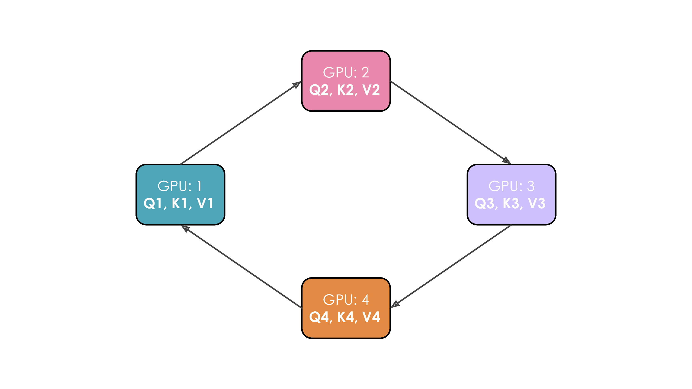
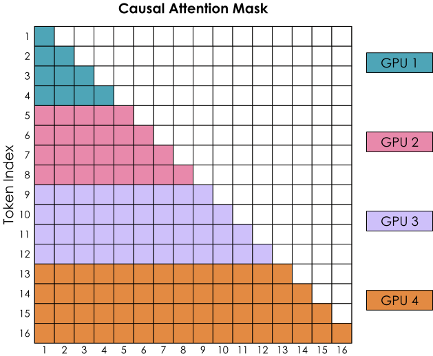
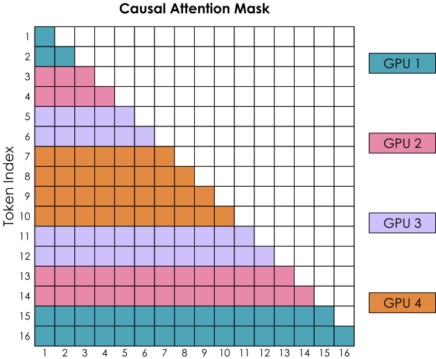
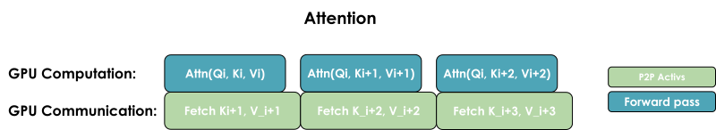

# 第 4 章　上下文并行（Context Parallelism）

> 译自 Hugging Face nanotron 团队《The Ultra-Scale Playbook: Training LLMs on GPU Clusters》（Apache 2.0），原文为 [Hugging Face Space](https://huggingface.co/spaces/nanotron/ultrascale-playbook)。

有了张量并行（tensor parallelism, TP）与序列并行（sequence parallelism, SP），我们已经能大幅降低每张 GPU 的内存需求，因为模型权重与激活值（activations）都分散到多张 GPU 上了。然而，当我们要在越来越长的序列上训练模型（例如每条序列扩展到 128k 个以上的 token）时，仍可能超出单个节点的可用内存，因为在 TP 区域内部，我们依然得处理完整长度的序列。

即使对激活值采用完整重计算（full recomputation），付出约 30% 的额外计算成本，仍需在内存中保留层边界处的部分激活值，而这些激活值会随序列长度线性增长。下面看看上下文并行（context parallelism, CP）如何解决这个问题：

> 🔬 原文此处为交互图表（8B 模型在不同上下文并行度下的内存占用），可前往[原网页](https://huggingface.co/spaces/nanotron/ultrascale-playbook)体验。

上下文并行的核心思路，是把序列并行中“沿序列长度切分”的做法扩展到已经采用张量并行的模块。这样一来，这些模块会同时沿两个维度切分，序列长度带来的内存压力也随之降低。这个思路看起来很直观，但真正实现时还有一个关键问题。

采用上下文并行时，就像序列并行一样，我们沿着序列维度切分输入；但这次我们把这个切分应用到整个模型，而不是像先前 TP + SP 那样，只切在模型的序列并行区域。

切分序列并不影响 MLP、LayerNorm 等大多数模块，因为其中每个 token 都是独立处理的。它也不像 TP 需要昂贵的通信，因为被切分的只有输入，而不是权重矩阵。和数据并行（data parallelism）一样，在算完梯度之后，我们会发起一次 all-reduce 操作，在上下文并行组内同步梯度。

不过，**注意力模块**（attention blocks）是一个重要例外。在注意力计算中，每个 token 都需要访问序列中**所有**其他 token 的键／值对（key/value pairs）；即使使用因果注意力（causal attention），也至少需要访问它之前的全部 token。

由于上下文并行是沿着序列维度把输入切分到多张 GPU 上，注意力模块将需要 GPU 之间的完整通信，来交换所需的键／值数据。

如果直接交换所有数据，通信代价会非常高。有没有办法兼顾速度和内存效率？答案就是**环状注意力（Ring Attention）**：它能更高效地组织键／值对的通信。

> 📝 **注**：上下文并行与 FlashAttention（后文会再详细介绍）在概念上有些相似——两者都依赖在线 Softmax（online softmax）计算来降低内存占用。差别在于 FlashAttention 专注于优化单张 GPU 上的注意力计算本身，而上下文并行则是通过把序列分散到多张 GPU 上来实现内存的缩减。

## 初探环状注意力（Ring Attention）

在这种实现中，每张 GPU 会先发起异步通信，将自己的键／值对发送给其他 GPU。在等待数据的同时，它会用本地已有的数据计算注意力分数。理想情况下，当前一轮计算结束前，下一份键／值对已经从相邻 GPU 传来，因此可以立即开始下一轮计算。

让我们把这个过程具体画出来。假设有 4 张 GPU，输入包含 4 个 token。输入序列首先沿序列维度均匀切分，因此每张 GPU 只持有一个 token 及其对应的 Q/K/V。Q1、K1、V1 分别表示第一个 token 的查询（query）、键（key）和值（value），位于第 1 张 GPU 上。整个注意力计算需要 4 个时间步；每个时间步中，每张 GPU 依次执行以下三个操作：

1. 以非阻塞（non-blocking）方式，将“当前的键和值”发送给环中的下一张 GPU（最后一个时间步除外），使通信可以与后续计算重叠。
2. 使用本地已有的“当前键和值”计算注意力，通常就是计算 $Softmax(\frac{QK^T}{\sqrt{d}}) * V$。
3. 等待接收上一张 GPU 发来的键和值，然后回到步骤 1；此时，“当前的键和值”已经替换为刚收到的数据。

我们把这 3 个步骤运行四次，就能完成整个注意力计算。

以 4 张 GPU 进行的完整流程如下面的动画所示：

*4 张 GPU 以环状方式传递键／值对、同时计算注意力的完整过程动画。*

从动画中可以直观看出“环状注意力”这一名称的由来。

不过，环状注意力的朴素实现存在一个严重问题：因果注意力矩阵的形状会导致 GPU 之间负载不均。下面通过带有因果注意力掩码（causal attention mask）的注意力分数矩阵，观察 Softmax 的计算过程：

*朴素的顺序切分下，因果注意力掩码对应的注意力分数矩阵：各 GPU 分到的计算量严重不均。*

Softmax 按行（row-wise）计算。也就是说，只要某张 GPU 收齐某一行所需的全部 token，就可以计算这一行。GPU 1 可以立即开始，因为它最初就持有 token 1–4，无需从其他 GPU 接收数据；GPU 2 则要到第二轮收到 token 1–4 后，才能凑齐 token 1–8 所需的全部值。因此，GPU 1 的工作量也明显少于其他 GPU。

让我们看看能不能把计算分配得更平均一些：

## 锯齿环状注意力（Zig-Zag Ring Attention）——计算平衡的实现

我们需要更好的输入序列分配方式。做法是不再把 token 纯粹按顺序分配给各 GPU，而是稍微打散排列顺序，让每张 GPU 上都均匀混有前段与后段的 token。这个方法称为锯齿注意力（Zig-Zag Attention）。在这种新的排列下，注意力掩码会呈现均匀分布的计算量；只要数一数涂色方格的数量，你就会发现计算现在已经平均分摊到所有 GPU 上了。

> 📝 **注**：我们这里展示的是锯齿注意力（Zig-Zag Attention），它与条纹注意力（Striped Attention）略有差异；关于两者差异的细节，可参考[这则 GitHub 讨论](https://github.com/zhuzilin/ring-flash-attention/issues/2#issuecomment-2236746166)。

*锯齿排列下的注意力掩码：计算量已平均分摊到所有 GPU。*

同时可以看到，要完成所有行的计算，每张 GPU 都需要来自其余 GPU 的信息。

要让计算与通信重叠，通常有两种做法：一是运行一次完整的 all-gather，将全部 KV 收集到每张 GPU 上（类似 ZeRO-3）；二是让 KV 块在 GPU 之间按需逐步传递：

*All-gather 实现：一次同时收齐所有键／值对。*

*All-to-all（环状）实现：以环状模式一次交换一个块的键／值对。*

这两种实现的关键差异，在于它们的通信模式与内存占用：

**1. All-gather 实现：**

* 所有 GPU 同时向其他所有 GPU 收集完整的键／值对
* 需要更多临时内存，因为每张 GPU 必须一次存放完整的 KV 对
* 通信一步到位，但内存开销较大

**2. All-to-all（环状）实现：**

* GPU 以类似环状的模式交换 KV 对，一次一个块
* 内存效率更高，因为每张 GPU 一次只需临时存放一个额外的数据块
* 通信被分散开来并与计算重叠，不过多次通信步骤会带来一些额外的基础延迟开销

整体而言，all-to-all 通过更复杂的通信模式换取了更高的内存效率；all-gather 虽然更简单，但在注意力计算期间需要更多临时内存。

到目前为止，我们已经看到如何在单个节点内使用 TP 切分大模型，以及如何使用 CP 控制长序列导致的激活值增长。

然而，TP 很难跨节点扩展。如果模型权重连一个节点都无法容纳，就需要引入第四种并行方式：**流水线并行（Pipeline Parallelism）**。
