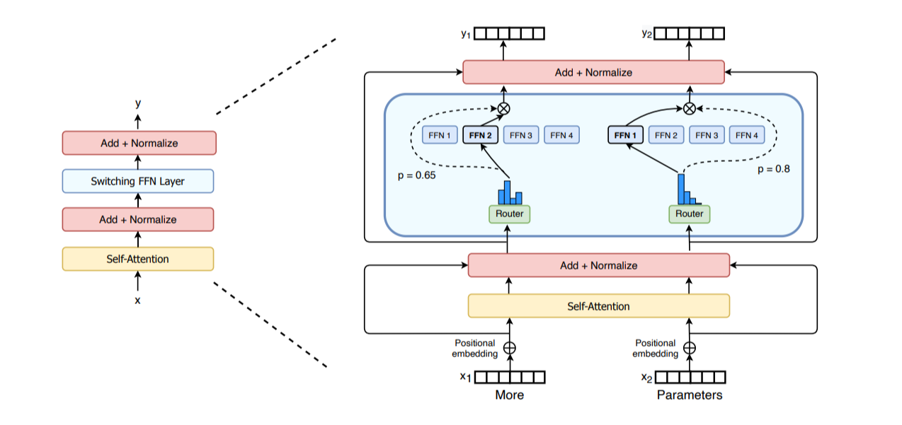
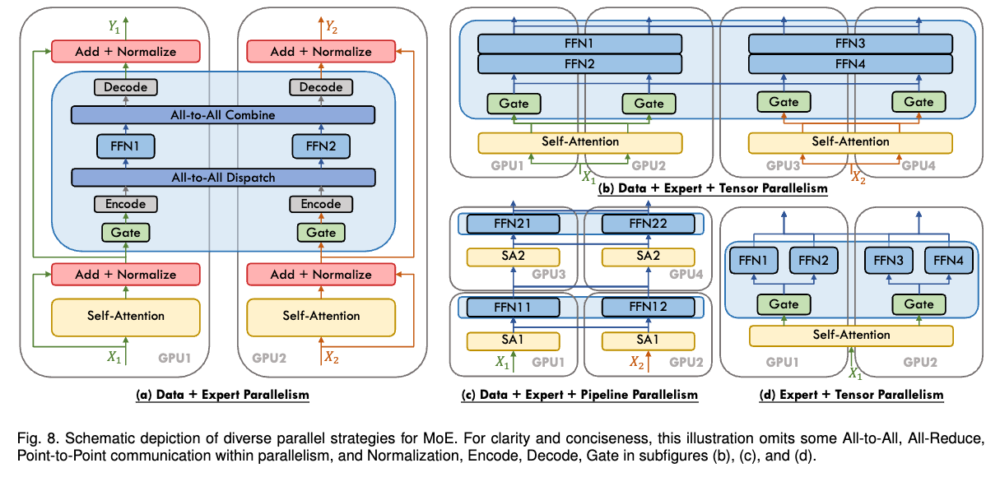

# 第 6 章　专家并行（Expert Parallelism）

> 译自 Hugging Face nanotron 团队《The Ultra-Scale Playbook: Training LLMs on GPU Clusters》（Apache 2.0），原文为 [Hugging Face Space](https://huggingface.co/spaces/nanotron/ultrascale-playbook)。

这是我们要讨论的最后一种并行方法。在深入探讨之前，如果你从未接触过混合专家（Mixture of Experts, MoE）模型，不妨先读读我们先前发表的[这篇篇幅短得多的博客文章](https://huggingface.co/blog/moe)，它应该能帮助你更全面地理解 MoE 架构。

混合专家模型近来随着 GPT-4、Mixtral，以及更晚近的 DeepSeek-V3/R1 等模型而备受瞩目。其基本想法是：每一层不再只有一个前馈（feedforward）模块，而是可以有多个并行的模块，并将 token 路由（route）到其中某一个模块，以不同的方式处理。

*MoE 层的示意图，取自 Switch Transformers 论文*

MoE 层的设计很适合沿专家维度并行化，这就是所谓的**专家并行（expert parallelism, EP）**。由于各个前馈层彼此完全独立，我们可以直接把每个专家的前馈层放在不同的工作节点（worker）上。与张量并行（tensor parallelism, TP）相比，这种方式轻量得多：无需切分矩阵乘法，只需把 token 的隐藏状态路由到正确的专家即可。

实践中，EP 通常会与其他形式的并行搭配使用——例如数据并行（data parallelism, DP）。这是因为 EP 只影响 MoE 层，并不会切分输入的 token（不像上下文并行（context parallelism, CP）会沿着序列长度维度切分 token）。这表示如果我们只使用 EP，GPU 就会对所有非 MoE 的块做重复的计算。通过将 EP 与 DP 结合，我们就能高效地把专家和输入批量都切分到各个 GPU 上，如下方的简化示意图所示：

*数据源：《A Survey on Mixture of Experts》*

不过我们先别操之过急——接下来的一节会专门讨论不同并行策略之间的各种交互作用，所以如果你还看不懂最后这张图，也不用担心。

在实践中，要让 EP 高效运行还需要一些与模型设计紧密相关的技巧。例如，DeepSeek-V3 对路由器（router）施加限制，确保每个 token 最多只会被送往 $M$ 个节点（其配置中为 4 个），以尽量将 token 留在单个节点内，减少通信开销。专家并行并不是新技术，但随着 MoE 架构日益受到关注，如今又重新成为焦点。

我们计划不久之后在 picotron/nanotron 中加入更完整的 EP 示例，敬请期待！
