# 第 9 章　深入 GPU：架构与内核（Diving in the GPUs: Architecture & Kernels）

> 译自 Hugging Face nanotron 团队《The Ultra-Scale Playbook: Training LLMs on GPU Clusters》（Apache 2.0），原文为 [Hugging Face Space](https://huggingface.co/spaces/nanotron/ultrascale-playbook)。本章为原书“Diving in the GPUs”前半。

> 🎧 原文此处嵌入了一段由 NotebookLM 主持人讨论本章内容的 Podcast 音频，让你在阅读时能有边听边读的体验，可前往[原网页](https://huggingface.co/spaces/nanotron/ultrascale-playbook)聆听。

到目前为止，我们主要讨论模型计算的整体组织方式：如何在加速器之间分配计算，以及如何处理全局内存限制和计算单元的高层调度。

但还有一个重要层面：理解模型计算在单张 GPU 上如何调度和执行，可以帮助我们从更底层进一步优化性能。

本节将深入探讨 GPU 架构的更多细节，特别是 NVIDIA 的 GPU 架构；不过一如既往，这些一般性的概念也能应用到其他类似的加速器上。

我们会先简要说明 GPU 的组织方式，接着介绍 Flash-Attention 带来的革命、如何高效地在 GPU 上调度工作负载，最后说明如何在 GPU 上高效地运用各种数值精度。

## GPU 基础入门（A primer on GPU）

GPU 采用多层次的组织结构。本节只介绍理解后续内容所需的基本概念。

在计算方面，GPU 由一组**流式多处理器（Streaming Multiprocessor, SM）**组成。每个 SM 包含并控制多个流处理器，也就是通常所说的核心（core）。例如，NVIDIA H100 有 132 个 SM，每个 SM 有 128 个核心，共计 16,896 个核心（详见 [Tensor Core 文档](https://resources.nvidia.com/en-us-tensor-core)）。

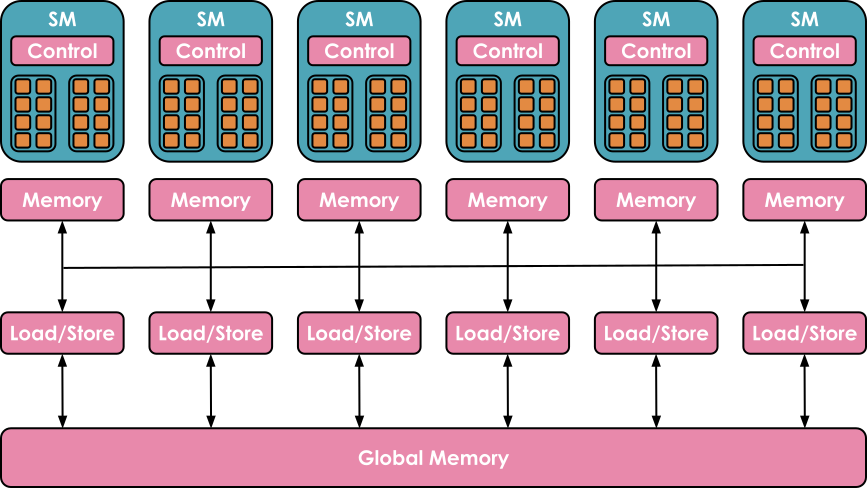

*图片来源：https://blog.codingconfessions.com/p/gpu-computing*

GPU 的内存体系同样高度分层：**寄存器（register）**容量最小，由各线程独占；**共享内存（shared memory）**和 **L1 缓存**由同一个 SM 上的线程共享；再往上是所有 SM 共用的 **L2 缓存**；最后是容量最大、但访问速度也最慢的**全局内存（global memory）**，例如 H100 标称的 80 GB 内存。

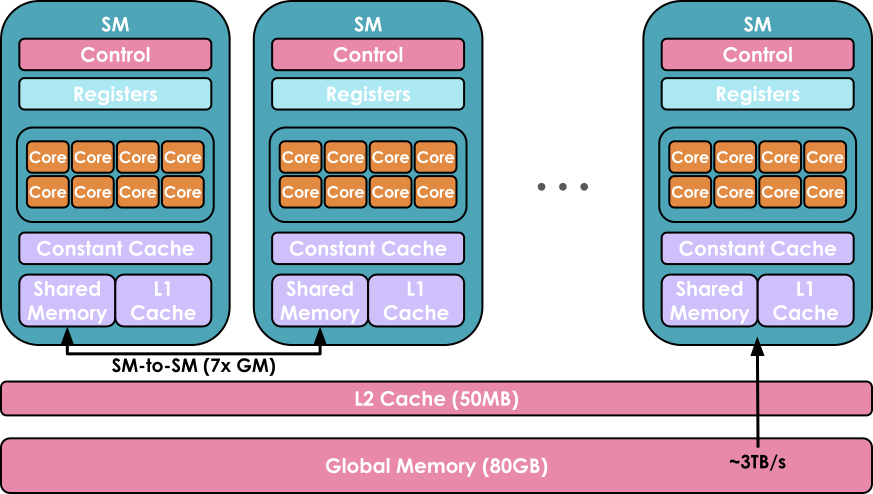

*图片来源：https://www.youtube.com/watch?v=ZQKMZIP3Fzg*

使用 GPU 的目标，就是充分利用这种分层的计算与内存体系，让尽可能多的工作负载在 GPU 核心上并行运行。

在 GPU 核心上运行的程序称为 **kernel（内核）**。内核可以用 **CUDA** 或 **Triton** 等高级语言编写，再编译为 NVIDIA GPU 使用的底层中间表示 Parallel Thread Execution（PTX）。

要运行内核，还需要一段**主机端代码（host code）**。它在 **CPU／主机**上执行，负责配置运行环境，以及加载数据和代码：

```cpp
// 主机端代码（host code）
void vecAdd(float* h_A, float *h_B, float *h_c, int n) {
    // 在设备内存中配置向量
    int size = n * sizeof(float);
    float *d_A, *d_B, *d_C;
    cudaMalloc(&d_A, size);
    cudaMalloc(&d_B, size);
    cudaMalloc(&d_C, size);

    // 将向量从主机内存拷贝到设备内存
    cudaMemcpy(d_A, h_A, size, cudaMemcpyHostToDevice);
    cudaMemcpy(d_B, h_B, size, cudaMemcpyHostToDevice);

    // 启动 kernel
    int threadsPerBlock = 256;
    int blocksPerGrid =
            (N + threadsPerBlock - 1) / threadsPerBlock;
    VecAdd<<<blocksPerGrid, threadsPerBlock>>>(d_A, d_B, d_C, N);

    // 将结果从设备内存拷贝回主机内存
    // h_C 保存主机内存中的结果
    cudaMemcpy(h_C, d_C, size, cudaMemcpyDeviceToHost);

    // 释放设备内存
    cudaFree(d_A);
    cudaFree(d_B);
    cudaFree(d_C);
}
```

*两向量相加 CUDA kernel 的主机端代码，改编自 https://docs.nvidia.com/cuda/cuda-c-programming-guide/ 与 https://blog.codingconfessions.com/p/gpu-computing*

```cpp
// 设备端代码（device code）
__global__ void VecAdd(float* A, float* B, float* C, int N)
{
    int i = blockDim.x * blockIdx.x + threadIdx.x;
    if (i < N)
        C[i] = A[i] + B[i];
}
```

*设备端代码，内含向量加法 kernel 的定义，改编自 https://docs.nvidia.com/cuda/cuda-c-programming-guide/ 与 https://blog.codingconfessions.com/p/gpu-computing*

Kernel 的调度方式一般如下：

* 每 32 个线程组成一个**线程束（warp）**。同一个 warp 中的线程以锁步方式执行相同指令，但处理数据的不同部分。
* 多个 warp 组成更大的**线程块（block）**（例如包含 256 个线程）。每个 block 只会分配给一个 SM，而一个 SM 可以并行运行多个 block。受资源限制，部分 block 可能需要进入等待队列，直到资源释放。

这里最重要的一点是：GPU 在多个方面存在容量和配置限制，包括各层内存的容量、可并行运行的 block 数量，以及 warp 中的线程数量。只有充分考虑这些限制，才能高效利用 GPU 架构。

大多数时候你并不需要深入到这种精细的层次，而且幸运的是，你通常可以直接重用社区其他成员准备好的 kernel 与代码。但无论如何，我们还是想带你入门，看看该如何开始编写 kernel！

## 如何用 kernel 提升性能？（How to improve performance with Kernels?）

如果你想添加一个还没有优化 kernel 的运算，或是想加速某个既有的 PyTorch 函数，从零开始编写 kernel 看起来或许是最直接的途径。然而，从头打造高性能的 CUDA kernel 需要丰富的经验，学习曲线也相当陡峭。通常比较好的入门方式是利用 `torch.compile`：它会捕捉你的运算并动态优化 PyTorch 代码，生成以 Triton 编写的底层高性能 kernel。

假设你想为一个叫做指数线性单元（Exponential Linear Unit, ELU）的激励函数编写 kernel：

$$
\text{ELU}(x) = \begin{cases}
e^x - 1 & \text{if } x < 0 \\
x & \text{if } x \geq 0
\end{cases}
$$

你可以先写一个简单的 PyTorch 实现，然后在上面加上 `@torch.compile` 装饰器即可：

```python
@torch.compile
def elu(x, alpha=1.0):
    return torch.where(x < 0, alpha * (torch.exp(x) - 1), x)
```

编译版与未编译版之间的差距非常惊人，尤其是考虑到我们只加了一个装饰器而已。下图清楚呈现了这个显著的差异（其中 $N$ 为行数）：

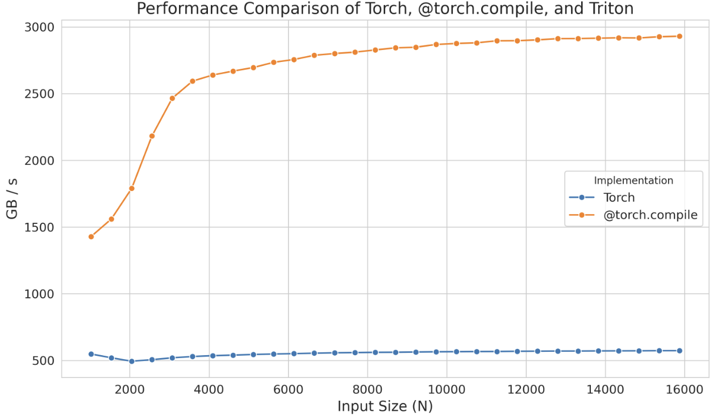

不过，如果这样的性能提升还不够，你可以考虑自行实现 Triton kernel。作为起点，你可以先看看 `@torch.compile` 生成的 Triton kernel。方法很简单，只要把环境变量 `TORCH_LOGS` 设为 `"output_code"`：

```bash
export TORCH_LOGS="output_code"
```

接着运行带有 `@torch.compile` 装饰器的 Python 脚本，它就会生成并输出对应的 Triton kernel，在这个例子中是：

```python
@triton.jit
def triton_(in_ptr0, out_ptr0, xnumel, XBLOCK : tl.constexpr):
    xnumel = 100000000
    xoffset = tl.program_id(0) * XBLOCK
    xindex = xoffset + tl.arange(0, XBLOCK)[:]
    xmask = xindex < xnumel
    x0 = xindex
    tmp0 = tl.load(in_ptr0 + (x0), xmask)
    tmp1 = 0.0
    tmp2 = tmp0 < tmp1
    tmp3 = tl_math.exp(tmp0)
    tmp4 = 1.0
    tmp5 = tmp3 - tmp4
    tmp6 = tl.where(tmp2, tmp5, tmp0)
    tl.store(out_ptr0 + (x0), tmp6, xmask)
```

为了提升可读性，我们可以修改变量名称、加上注解，并做些微调（或请 LLM 帮我们做），如下所示：

```python
@triton.jit
def elu_kernel(input_ptr, output_ptr, num_elements, BLOCK_SIZE: tl.constexpr):
    # 计算此块的起始索引
    block_start = tl.program_id(0) * BLOCK_SIZE
    # 创建此块的索引数组
    block_indices = block_start + tl.arange(0, BLOCK_SIZE)[:]
    # 创建掩码，确保只处理有效的索引
    valid_mask = block_indices < num_elements
    # 依据有效索引，从输入指针加载输入值
    input_values = tl.load(input_ptr + block_indices, valid_mask)
    # 定义 ELU 的参数
    zero_value = 0.0  # ELU 激励的门槛值
    negative_mask = input_values < zero_value
    exp_values = tl.math.exp(input_values)
    # 定义 ELU 输出的位移量
    one_value = 1.0
    shifted_exp_values = exp_values - one_value

    output_values = tl.where(negative_mask, shifted_exp_values, input_values)

    # 将计算好的输出值写回输出指针
    tl.store(output_ptr + block_indices, output_values, valid_mask)
```

这里的 `tl.program_id(0)` 会提供一个唯一的 block ID，我们用它来决定该 block 要处理哪一段数据。利用这个 block ID，`block_start` 计算出每个 block 负责区段的起始索引，而 `block_indices` 则指定该区段内的索引范围。`valid_mask` 确保只有 `num_elements` 范围内的索引会被处理，让 `tl.load` 能安全地加载数据。接着应用 ELU 函数，依据数值是否为负来修改它们，最后用 `tl.store` 把结果写回内存。

当我们用 `triton.testing.Benchmark` 对生成的 kernel 进行基准测试时，得到以下性能：

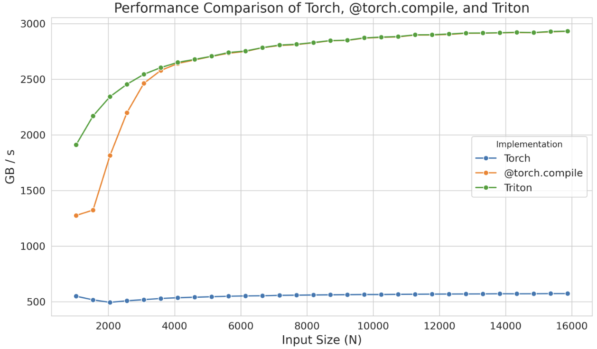

这个独立的 kernel 在较小的尺寸下甚至展现出比 `@torch.compile` 更好的性能，但这很可能只是 `torch.compile` 编译时间造成的假象。无论如何，请记住：与其从零开始，你可以从这类自动生成的 kernel 出发，把精力集中在优化其性能上，替自己省下大量时间。

即使用了 Triton，有时我们仍然无法完全榨出设备的峰值性能，因为这个语言在处理底层细节——例如共享内存以及流式多处理器（SM）内部的调度——上有其限制。Triton 的能力仅止于 block 层级，以及 block 在各 SM 之间的调度。若想获得更深入的控制权，你就需要直接用 CUDA 实现 kernel，在那里你可以触及所有底层的底层细节。

下探到 CUDA 之后，有各式各样的技巧可以用来提升 kernel 的效率。这里我们只介绍其中几种：优化内存访问模式以降低延迟、利用共享内存存放频繁访问的数据，以及管理线程的工作负载以减少闲置时间。

在更深入 CUDA 示例之前，先总结一下我们看过的、可以编写 kernel 代码在 GPU 上运行指令的工具：

1. PyTorch：简单但慢
2. torch.compile：简单、快速，但缺乏弹性
3. Triton：较难、更快，也更有弹性
4. CUDA：最难、最快、也最有弹性（前提是你写得对）

我们先来谈谈 CUDA 中最常用的技巧之一：优化内存访问。与缓存相比，GPU 的全局内存（也就是上图中最大的那块内存）延迟更高、带宽更低，往往是多数应用程序的主要瓶颈。提高全局内存访问效率，可以显著改善性能。

### 内存合并访问（Memory Coalescing）

要有效利用全局内存的带宽，就必须先了解它的架构。在 CUDA 设备中，全局内存是用 DRAM 实现的。

**内存合并访问（memory coalescing）**利用了 DRAM 的突发传输（burst）特性。访问某个内存地址时，DRAM 会并行读出包含该地址在内的一段连续位置，再将这些数据快速传给处理器。CUDA 通过让同一个 warp 中的 32 个线程访问连续地址，将多个请求合并为一次突发传输，从而提高内存访问效率。例如，线程 0、1、2 分别访问 $M$、$M + 1$、$M + 2$ 时，GPU 会将这些请求合并（coalesce），而不是逐一处理。

以矩阵乘法为例。一个简单直白的实现，会让每个线程计算输出矩阵的一个元素，像这样：

```cpp
__global__ void matmul_naive(int M, int N, int K, const float *A, const float *B, float *C) {
    const uint x = blockIdx.x * blockDim.x + threadIdx.x;
    const uint y = blockIdx.y * blockDim.y + threadIdx.y;

    if (x < M && y < N) {
        float tmp = 0.0;
        for (int i = 0; i < K; ++i) {
            tmp += A[x * K + i] * B[i * N + y];
        }
        C[x * N + y] = tmp;
    }
}
```

这篇[博客文章](https://siboehm.com/articles/22/CUDA-MMM)直观展示了这个内核的工作方式：

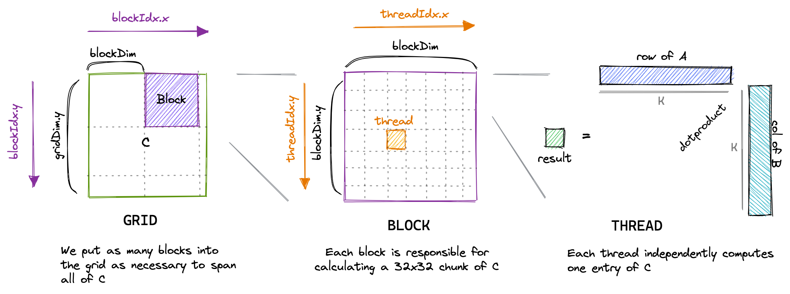

然而，用 `ncu` 这类工具对这个 kernel 进行剖析（profiling）时，我们会看到一些问题，包括内存吞吐量偏低，以及未合并的内存访问：

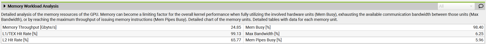

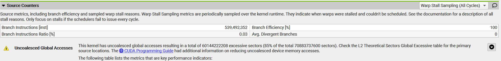

原因在于：这个内核中，同一个 block 内线程 ID 为 `(0, 0)` 和 `(1, 0)` 的两个线程（它们最终会落在同一个 warp）会加载矩阵 `B` 中的同一个元素，却会加载矩阵 `A` 中同一列、不同行的元素。矩阵采用行优先（row-major）顺序存储，也就是同一行中的元素位于连续的内存地址。在第一次迭代 `i = 0` 时，线程 `(0, 0)` 加载 $A_{0,0}$，线程 `(1, 0)` 加载 $A_{1,0}$；二者在内存中并不相邻。每次迭代都会出现这种跨步访问，因此这些内存访问无法合并。

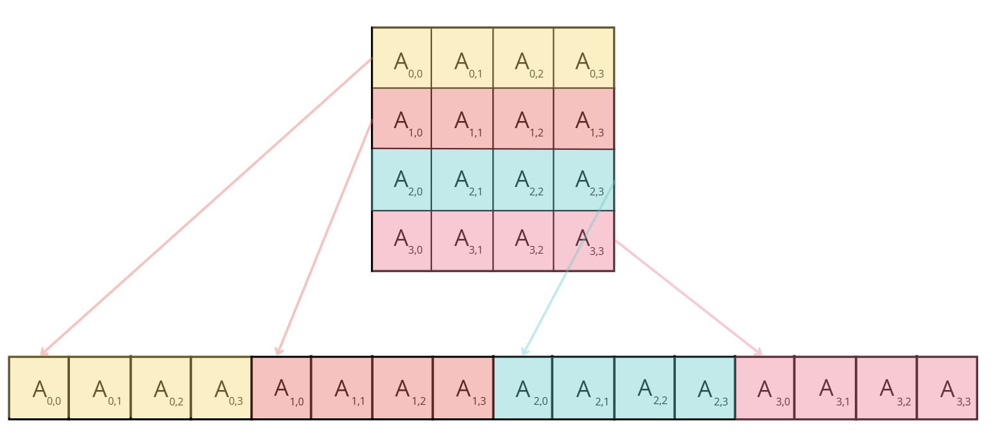

要改善这个内核的性能，可以按如下方式修改坐标 `x` 和 `y` 的计算：

```cpp
const int x = blockIdx.x * BLOCKSIZE + (threadIdx.x / BLOCKSIZE);
const int y = blockIdx.y * BLOCKSIZE + (threadIdx.x % BLOCKSIZE);

if (x < M && y < N) {
    float tmp = 0.0;
    for (int i = 0; i < K; ++i) {
        tmp += A[x * K + i] * B[i * N + y];
    }
    C[x * N + y] = tmp;
}
```

这里不再使用 2D block，而是改用 1D block，并重新定义 `x` 和 `y`。采用这种映射后，同一个 warp 内的线程（其 `threadIdx.x` 值彼此接近）拥有相同的 `x`、不同的 `y`。也就是说，它们会重复读取矩阵 `A` 的同一个元素，同时读取矩阵 `B` 同一行中的相邻元素。对于行优先存储的矩阵，这样的内存访问就可以合并。

对新 kernel 进行剖析时，我们注意到关于未合并内存访问的警告消失了，而且 **GPU 的内存吞吐量提升了大约 10 倍**。

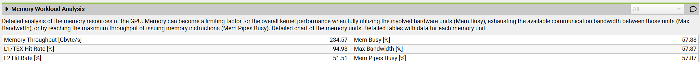

同时，内核的运行时间也**缩短至原来的十分之一**。

接下来介绍另一个文献中常见的技巧：**tiling（分块）**。

### Tiling（分块）

Tiling 是一种利用*共享内存*来优化内存访问模式的技巧。如前所述，共享内存是一块小而快的内存，同一个 block 内的所有线程都能访问。它让数据可以被多个线程重复使用，减少从较慢的全局内存反复加载数据的需求。

以矩阵乘法为例，block 中的每个线程可能都需要两个矩阵（比如 A 和 B）的元素。如果每个线程都各自从全局内存加载它需要的列与行，就会出现大量重复加载，因为 block 内的多个线程会访问彼此重叠的数据。取而代之，我们可以用 tiling 的方式，把 A 和 B 的一个块（即 tile）一次性加载共享内存，让该 block 内的所有线程重复使用这份共享数据。

采用 tiling 时，每次迭代都由 block 内的线程协同将两个 tile 加载到共享内存：一个来自矩阵 A，大小为 `BLOCK_SIZE_M` × `BLOCK_SIZE_K`；另一个来自矩阵 B，大小为 `BLOCK_SIZE_K` × `BLOCK_SIZE_N`。数据进入共享内存后，线程便在两个 tile 上执行矩阵乘法。各 tile 的乘积会累加到保存中间结果的矩阵中，直到所有 tile 都处理完毕。

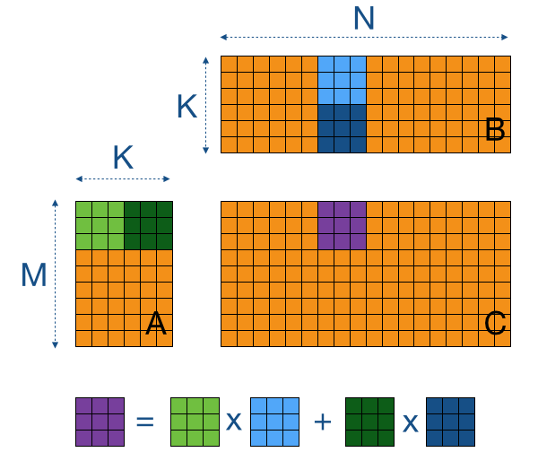

*图片来源：<https://cnugteren.github.io/tutorial/pages/page4.html>*

来看看实现中你需要理解的重点部分：

```cpp
// 将指针设置到起始元素
A += blockRow * TILE_SIZE * K; // 从 row = blockRow、column = 0 开始
B += blockCol * TILE_SIZE; // 从 row = 0、column = blockCol 开始
C += blockRow * TILE_SIZE * N + blockCol * TILE_SIZE; // 从 row = blockRow、column = blockCol 开始
float sum = 0.0;
// 外层循环依序走访 A 的 tile（沿水平方向）与 B 的 tile（沿垂直方向）
for (int tileIdx = 0; tileIdx < K; tileIdx += TILE_SIZE) {
    sharedA[localRow * TILE_SIZE + localCol] = A[localRow * K + localCol];
    sharedB[localRow * TILE_SIZE + localCol] = B[localRow * N + localCol];

    // 确保 block 内所有线程都已完成数据加载
    __syncthreads();

    // 将指针移到下一个 tile
    A += TILE_SIZE;
    B += TILE_SIZE * N;

    // 计算此 tile 的部分内积
    for (int i = 0; i < TILE_SIZE; ++i) {
        sum += sharedA[localRow * TILE_SIZE + i] * sharedB[i * TILE_SIZE + localCol];
    }
    // 再次同步，避免任何线程在其他线程尚未完成计算前
    // 就把新数据加载共享内存
    __syncthreads();
}
C[localRow * N + localCol] = sum;
```

> 📝 **注**：为简化说明，这里假设 tile 为正方形。

每个线程首先从**矩阵 A** 和**矩阵 B** 各加载一个元素到共享内存。此时要实现合并内存访问很简单：让 `threadIdx.x` 对应**局部列索引（localCol）**，同一个 warp 内的线程就会访问两个矩阵中的相邻元素。等 block 内的所有线程都把元素加载到共享内存后（通过 `__syncthreads()` 同步），它们便开始计算两个 tile 的内积。遍历完所有 tile 后——对**矩阵 A** 沿水平方向、对**矩阵 B** 沿垂直方向——最终结果会写入**矩阵 C** 的对应位置。

用 `ncu` 对这个 kernel 进行基准测试时，我们发现内存吞吐量提升到 410 Gb/s，kernel 运行时间缩短了约 43%，达到约 6.6 TFLOPs 的性能。

### 线程粗化（Thread Coarsening）

Tiling 技巧已经大幅提升了我们 kernel 的性能。不过，当我们分析量化各状态所耗周期数的 warp 状态时，观察到以下情况：

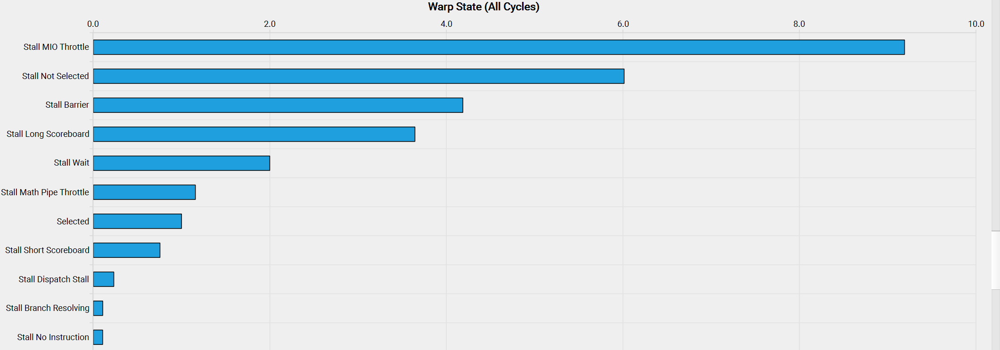

这些晦涩的状态名称的含义可以在 [NVIDIA 的剖析指南](https://docs.nvidia.com/nsight-compute/ProfilingGuide/index.html#metrics-reference)的 **Warp Stall Reasons** 一节中找到。我们可以在那里读到：

> *`smsp__pcsamp_warps_issue_stalled_mio_throttle`：warp 因等待 MIO（内存输入／输出）指令队列腾出空间而停滞。当 MIO 流水线被极度使用时——这包括特殊数学指令、动态分支以及共享内存指令——这项停滞原因的占比会偏高。若起因是共享内存访问，尝试改用较少但较宽的加载可以降低流水线压力。*

看来 warp 正因为等待共享内存访问的返回而停滞！要解决这个问题，我们可以应用一种称为**线程粗化（thread coarsening）**的技巧：把多个线程合并成一条“粗化”的线程。由于每条粗化后的线程可以处理多个输出元素，共享内存的访问次数会显著减少。

最后，让我们简要地谈谈编写或改进自定义 kernel 时的最后一项重要考虑：**减少控制发散（minimizing control divergence）**。

### 减少控制发散（Minimizing Control Divergence）

流式多处理器（SM）以单指令多数据（Single Instruction, Multiple Data, SIMD）模式执行 warp 中的线程：同一时刻，warp 内的所有线程执行同一条指令，但处理不同的数据。SIMD 的优势在于多个执行单元可以共享取指和指令分派硬件，从而减少控制逻辑的开销，把更多硬件资源用于提升算术吞吐量。

当同一个 warp 内的线程走上不同的执行路径时，就会发生控制发散（control divergence）。例如，`if` 语句可能让部分线程执行一段代码、其余线程执行另一段代码，此时 warp 必须串行执行这些路径，未参与当前分支的线程只能等待。要减少控制发散，应尽量让同一个 warp 内的线程遵循相同路径，例如减少条件分支、调整数据结构，或采用谓词化（predication）等技巧。

---

至此，我们介绍了编写自定义内核，以及优化 GPU 计算性能和内存占用时的主要注意事项。在进入实际示例之前，还要介绍一个重要概念：**内核融合（kernel fusion）**。
